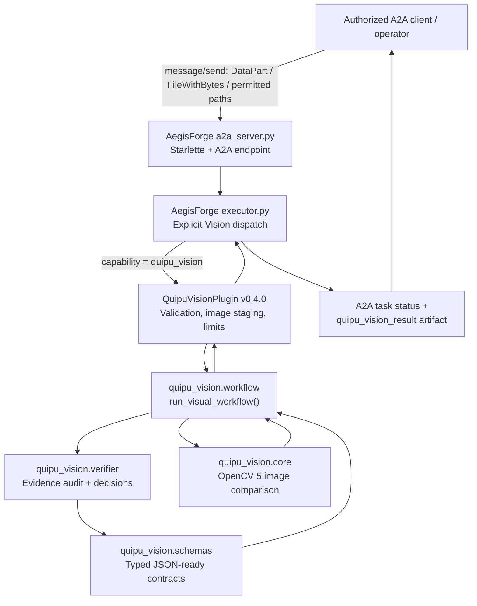
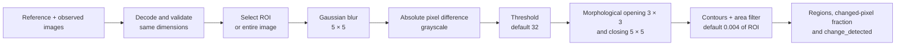
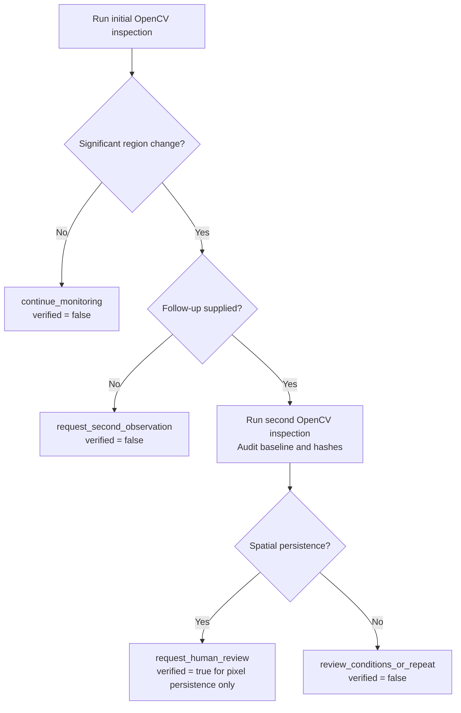
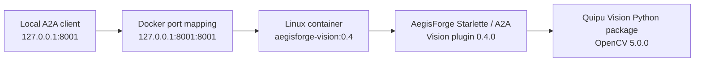
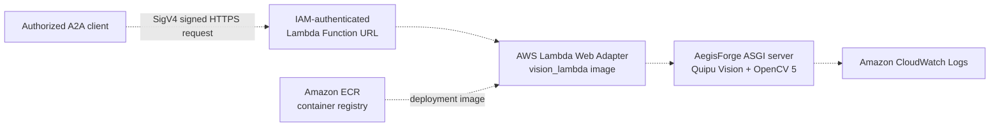

# Quipu Vision — Technical Architecture

**Project:** Quipu Vision, integrated with AegisForge  
**Submission context:** OpenCV AI Competition 2026  
**Implementation described:** Quipu Vision plugin **0.4.0**, using **OpenCV 5.0.0** in the reported Windows and Docker verification runs  
**Architecture status:** Locally implemented and tested; **AWS deployment remains unverified**  
**Repository root:** `AegisForge_agent/`

> **Scope:** Quipu Vision is an evidence-driven *visual scene-change detector*. It compares images, identifies changed pixel regions, optionally checks whether those regions persist in a supplied follow-up image, and recommends an appropriate next action. It **does not** identify objects, autonomously acquire camera frames, process video streams, or certify physical safety.

## 1. System overview

Quipu Vision is an optional capability of the existing AegisForge Agent-to-Agent (A2A) server. Its domain logic resides in a separate installable Python package at `Quipu-Vision/`; the AegisForge plugin, executor and server provide the integration layer.

The implemented architecture is a bounded, human-in-the-loop observation-to-decision workflow:

1. An A2A client supplies a **reference** image and an **observed** image.
2. OpenCV measures significant differences within the requested region of interest (ROI).
3. If no significant change is detected, the workflow recommends continued monitoring.
4. If a change is detected without a follow-up image, the workflow requests a second observation.
5. When the client supplies a **follow-up** image, the workflow performs a second actual OpenCV inspection against the original reference, audits the evidence and checks spatial persistence.
6. It emits a machine-readable A2A result and a conservative next-action recommendation.

### 1.1 Implemented component diagram



**Dispatch is opt-in.** The environment variable `AEGISFORGE_ENABLE_QUIPU_VISION=true` enables the capability. The executor selects the Vision branch only when the incoming request explicitly supplies `capability: "quipu_vision"`. Unselected requests continue through the existing AegisForge routes; Quipu Vision is not an implicit classifier of ordinary prompts.

### 1.2 Implemented vs. prepared vs. pending

| Layer | Implementation | Evidence/status |
|---|---|---|
| OpenCV processing | `Quipu-Vision/src/quipu_vision/core.py` | Implemented; OpenCV 5.0.0 confirmed by developer's local output |
| Typed evidence and auditing | `schemas.py`, `verifier.py`, `workflow.py` | Implemented; functional tests pass |
| Plugin and input security | `src/aegisforge/plugins/examples/quipu_vision.py` | Plugin 0.4.0; integrated and locally tested |
| A2A dispatch and response | `src/aegisforge/executor.py`, `a2a_server.py` | Windows and Linux Docker A2A requests demonstrated |
| Local Linux container | Dockerfile target `vision` | Built and locally exercised |
| AWS container + infrastructure | Dockerfile target `vision_lambda`; `infra/aws/vision-lambda.yaml` | **Prepared, not confirmed deployed** |
| Real-world validation | Diverse photographs/camera sequences | **Pending**; synthetic evaluation is not field validation |

## 2. Python package responsibilities

| File / component | Responsibility |
|---|---|
| `Quipu-Vision/src/quipu_vision/core.py` | Load and decode images, enforce image-size/pixel limits, compare image pairs, extract changed regions, compute hashes, optionally write annotated output |
| `Quipu-Vision/src/quipu_vision/schemas.py` | Define `VisualObservation`, `VisualRegion`, `VisualVerification`, `VisualDecision`, and `VisionWorkflowResult`; validate data shape and serialize to JSON-ready objects |
| `Quipu-Vision/src/quipu_vision/verifier.py` | Audit consistency of engine results, image hashes and follow-up linkage; choose a conservative next action |
| `Quipu-Vision/src/quipu_vision/workflow.py` | Coordinate initial inspection, optional follow-up processing, evidence auditing and event trace |
| `src/aegisforge/plugins/examples/quipu_vision.py` | Translate validated plugin requests into the workflow; enforce bounded inputs, path containment and temporary-file cleanup |
| `src/aegisforge/executor.py` | Route explicitly selected A2A requests, normalize DataPart/FileWithBytes inputs, invoke the plugin and publish a result artifact |
| `src/aegisforge/a2a_server.py` | Serve the A2A application, health checks, agent cards and the opt-in Vision capability endpoint |

The `Quipu-Vision/` package and the `src/aegisforge/` package have separate `pyproject.toml` files. The nested Vision package must be installed in the runtime used by AegisForge.

## 3. OpenCV 5 processing pipeline

The current detector uses classic OpenCV operations rather than a neural-network object detector.



**Implementation details:**

- The reference and observed images must have identical dimensions.
- The ROI uses `[x, y, width, height]` in image pixel coordinates; omitted ROI means the entire image.
- The detector extracts external contours after thresholding and morphology, filters small candidate regions and returns up to 12 region records (plus the total count).
- The reported `changed_pixel_fraction` is a measurement of the thresholded difference mask, **not a confidence probability**.
- SHA-256 digests identify the source image bytes for audit and reproducibility.
- Optional annotated output marks the ROI and first-observation regions; annotations do not assert an object class.

**Spatial persistence:** when a follow-up is supplied, the same reference image is compared separately with the follow-up. Persistence requires change detection in both observations and a bounding-box intersection-over-union (**IoU**) of at least **0.2** between at least one pair of changed regions. This tests **spatially overlapping pixel changes**, not identity tracking across frames.

## 4. Visual reasoning and control flow



If an initial observation does **not** detect a change, the workflow does not consume an optional follow-up image merely because one was provided. If the initial report requests re-observation, an external client/operator must obtain and supply that image. The service is **not** a camera controller and does not promise an autonomous observation loop.

### 4.1 Decision contract

| Condition | Status / next action | Meaning of `verified` |
|---|---|---|
| No significant initial change | `no_significant_change` / `continue_monitoring` | `false` |
| Initial change, no follow-up | `awaiting_followup` / `request_second_observation` | `false` |
| Initial change, persistent spatial overlap in follow-up | `persistent_change_observed` / `request_human_review` | `true`: **pixel persistence only** |
| Initial change not confirmed spatially | `change_not_confirmed` / `review_conditions_or_repeat` | `false` |

The payload always states `safety_certified: false` and declares `verification_scope: "persistent_pixel_change_only"`. A human must interpret potentially consequential scene changes.

## 5. A2A transport and input contract

### 5.1 Routes

| Route or protocol | Purpose |
|---|---|
| `GET /health` | General server readiness and runtime status |
| `GET /vision/capabilities` | Opt-in capability/readiness information; **does not process images** |
| `GET /.well-known/agent-card.json` | A2A discovery information |
| A2A `message/send` on the server's A2A application | Actual image-processing requests and task responses |

### 5.2 Selection and operations

A Vision request must explicitly identify `capability: "quipu_vision"` in its A2A data/metadata. Supported plugin operations:

- **`inspect`** — initial image comparison; an optional follow-up may also be supplied.
- **`verify`** — requires a reference, observed and actual follow-up image; runs the bounded workflow.
- **`batch`** — evaluates up to eight independent cases; named A2A FileWithBytes parts are not supported in batch mode, but inline case images are.
- **`capabilities`** — returns supported modes and documented limits.

Image transport options are (1) paths within a configured input root, (2) base64-encoded image fields supplied in an A2A DataPart, or (3) A2A `FileWithBytes` parts named for their roles (`reference`, `observed`, `followup`). **Remote image URIs are not fetched.**

A successful Vision task publishes a machine-readable A2A artifact named **`quipu_vision_result`**. The artifact contains a `DataPart` with plugin status, output and warnings. The completion message summarizes operation, next action and verification state. An invalid request or processing error is surfaced as failure, **not** as a successful verified inspection.

### 5.3 Logical result envelope

The following illustrates **a subset of response fields** for an initial inspection that requests another observation. It is a **schematic response excerpt**, not a fabricated measured vision report:

```json
{
  "capability": "quipu_vision",
  "ok": true,
  "output": {
    "operation": "inspect",
    "status": "completed",
    "next_action": "request_second_observation",
    "verified": false,
    "safety_certified": false
  }
}
```

The actual `quipu_vision_result` artifact also carries structured observations, image hashes, decision reasons, workflow events and detailed evidence. Obtain those values from a real image-bearing request rather than substituting invented measurements.

## 6. Trust boundaries and failure handling

Quipu Vision exposes image-processing functionality, so the plugin and executor enforce bounded resource use and reject unsupported input sources:

- Accepted image formats: **PNG, JPEG, BMP and WebP**.
- Per-file path input maximum: **20 MiB**; decoded images: up to **12 million pixels**.
- Inline image maximum: **10 MiB per image**, **32 MiB per request**, with format-signature and declared MIME consistency checks.
- Allowed path inputs stay under `QUIPU_VISION_INPUT_ROOT`; annotated outputs stay under `QUIPU_VISION_OUTPUT_ROOT`.
- Inline images are staged in an isolated temporary directory and deleted when processing finishes.
- Batch execution is limited to **eight** cases and validated before per-case processing.
- A2A `FileWithUri`/arbitrary remote fetching is unsupported, reducing uncontrolled network retrieval risk.
- Malformed reports, inconsistent decisions/hashes/ROIs, invalid dimensions and processing exceptions are treated as errors.
- `verified` never means that a scene or people in it are safe; critical decisions require human review.

These checks address specific input and evidence risks; they are **not** a guarantee of security, privacy or regulatory compliance in an internet-facing deployment.

## 7. Deployment topology

### 7.1 Locally validated Docker topology



From the `AegisForge_agent/` root:

```powershell
# Build the previously tested Vision-specific Docker target.
docker build --target vision -t aegisforge-vision:0.4 .

# Run the existing AegisForge A2A server, bound only to the local host.
docker run --rm --name quipu-vision -p 127.0.0.1:8001:8001 aegisforge-vision:0.4
```

In a **second** terminal:

```powershell
Invoke-RestMethod http://127.0.0.1:8001/health
Invoke-RestMethod http://127.0.0.1:8001/vision/capabilities
```

These endpoints check readiness, **not** full image processing. An image-bearing `message/send` request is required to verify the complete A2A path. The developer previously demonstrated successful Docker image-bearing A2A verification, including `verified: true` and `next_action: request_human_review` for a persistent synthetic change.

### 7.2 Proposed AWS deployment — NOT yet validated

The AWS architecture is deliberately shown separately from the proven local design:



**Prepared components:**

- Dockerfile build target `vision_lambda`, based on the locally validated `vision` target and incorporating the AWS Lambda Web Adapter.
- CloudFormation template `infra/aws/vision-lambda.yaml`, describing a container-image Lambda function, IAM execution role, IAM-authenticated Function URL and CloudWatch log retention.
- Container image stored in ECR **if** a future authorized deployment is performed.
- `/tmp` configured for temporary image staging/output because the Lambda container's filesystem is otherwise read-only.

**CloudFormation configuration (declared, not deployed):** `x86_64` image architecture, 2,048 MiB memory, 90-second timeout, 512 MiB ephemeral storage, reserved concurrency of 2, and seven-day log retention. The Function URL uses `AWS_IAM`, rather than public anonymous access.

**Critical distinction:** No successful ECR push, Lambda stack creation, AWS-hosted image-processing request or AWS execution log has been supplied. The AWS diagram is a **deployment design**, not an as-built cloud deployment or contest-compliance claim. The IAM-protected URL would require properly authorized signed requests; it is not a public demo endpoint by default. AWS resources can incur charges if created or operated.

## 8. Validation evidence and results

### 8.1 Functional and integration validation

| Validation | Evidence reported | Status |
|---|---|---|
| Windows/OpenCV version | `cv2.__version__` reported **5.0.0** | Confirmed from developer output |
| Python workflow tests | **33 tests passed** in **0.870 seconds** | Confirmed from developer output |
| Windows A2A `inspect` | Follow-up requested for initial change | Previously demonstrated |
| Windows A2A `verify` | Persistent change leads to human review | Previously demonstrated |
| Local Linux Docker build | `vision` target built | Previously demonstrated |
| Local Linux Docker A2A | Image-bearing verification completed with OpenCV 5 | Previously demonstrated |
| AWS processing | No deployment evidence | **Pending** |

### 8.2 Synthetic benchmark

The developer ran the labeled **24-scenario synthetic evaluation** with **OpenCV 5.0.0**:

| Metric | Initial change detection (24 cases) | Spatial persistence (7 cases) |
|---|---:|---:|
| True positives | 12 | 4 |
| True negatives | 6 | 2 |
| False positives | 4 | 0 |
| False negatives | 2 | 1 |
| Accuracy | 75.00% | 85.71% |
| Precision | 75.00% | 100.00% |
| Recall | 85.71% | 80.00% |
| F1 | 0.8000 | 0.8889 |

The evaluation reported mean workflow processing time of **8.11 ms**, p95 of **14.56 ms**, **seven stage-level mismatches across six distinct scenarios**, and **zero execution errors**. Strong lighting, shadows, camera displacement and glare caused false positives; low-contrast changes were missed. These figures concern the synthetic dataset only and should not be used as field-performance estimates or safety measures.

For the full methodology, confusion matrices, mismatch descriptions and reproduction instructions, see [`evaluation.md`](./evaluation.md). The machine-readable results were generated locally at `outputs/quipu_vision/evaluation-results.json`; this document does not claim independent inspection of that private local JSON file.

## 9. Repository layout and reproducibility

```text
AegisForge_agent/
├── Dockerfile                                 # 'vision' and 'vision_lambda' targets
├── .dockerignore
├── pyproject.toml                             # AegisForge distribution
├── run.sh                                     # Starts existing A2A server
├── infra/
│   └── aws/
│       └── vision-lambda.yaml               # prepared deployment template
├── Quipu-Vision/
│   ├── pyproject.toml                         # separate Vision distribution
│   ├── README.md
│   ├── src/
│   │   └── quipu_vision/
│   │       ├── __init__.py
│   │       ├── __main__.py
│   │       ├── core.py
│   │       ├── schemas.py
│   │       ├── verifier.py
│   │       └── workflow.py
│   ├── examples/
│   │   ├── demo/                              # reference/observed/follow-up examples
│   │   └── evaluation/
│   │       ├── manifest.json
│   │       ├── evaluate.py
│   │       └── images/                        # synthetic labeled PNG assets
│   └── tests/
│       └── test_workflow.py
├── src/
│   └── aegisforge/
│       ├── a2a_server.py
│       ├── executor.py
│       └── plugins/
│           └── examples/
│               └── quipu_vision.py
├── docs/
│   └── competitions/
│       └── opencv/
│           ├── evaluation.md
│           ├── architecture.md              # this document
│           └── submission.md                # final submission write-up
└── outputs/
    └── quipu_vision/
        └── evaluation-results.json          # generated locally, not required in Git
```

**Important:** This layout describes the intended combined *local* working tree, including files prepared in this workflow. It is not an assertion that all files have already been committed and published to the remote GitHub branch. The original remote `main` previously inspected did not include all newly developed Vision files.

### 9.1 Re-run validation locally

From the repository root, using the AegisForge virtual environment in which `quipu-vision` and OpenCV 5 are installed:

```powershell
$python = ".\.venv\Scripts\python.exe"

& $python -c "import cv2; print(cv2.__version__)"

& $python -m unittest discover `
  -s ".\Quipu-Vision\tests" `
  -p "test_workflow.py" -v

& $python ".\Quipu-Vision\examples\evaluation\evaluate.py" `
  --json-out ".\outputs\quipu_vision\evaluation-results.json"
```

The tests do not require an AWS account. For full integration evidence, also perform the image-bearing A2A request against the enabled server, and save sanitized result artifacts/screenshots as submission evidence.

## 10. Current limitations and next work

- **AWS:** A significant component actually running on AWS remains unverified and is necessary to establish compliance with the competition's AWS requirement. Do not present a local Docker screenshot as cloud proof.
- **Real scenes:** Evaluate on consented, diverse fixed-camera images before claiming real-world reliability.
- **Image semantics:** Bounding-box change detection cannot determine what object caused the difference or whether a physical area is safe.
- **Robustness:** Strong illumination shifts, shadows, glare and camera movement created false positives in synthetic testing. Low-contrast objects created false negatives.
- **Capture:** Follow-up images are client-provided. No automatic camera control, live video analysis or automatic repeated capture is implemented.
- **Monitoring:** No persistent production storage, cross-request workflow state management or independently verified long-running cloud service is claimed.
- **Operational safeguards:** Any deployment needs explicit authorization, cost controls, appropriate access management and a privacy review for submitted imagery.

**Conclusion:** The locally validated system demonstrates a meaningful OpenCV 5 observation → decision → client-supplied re-observation → verification workflow with structured A2A evidence. Its deployed architecture is currently **Windows/Linux local**, with an **AWS Lambda/ECR design prepared but not deployed**.
