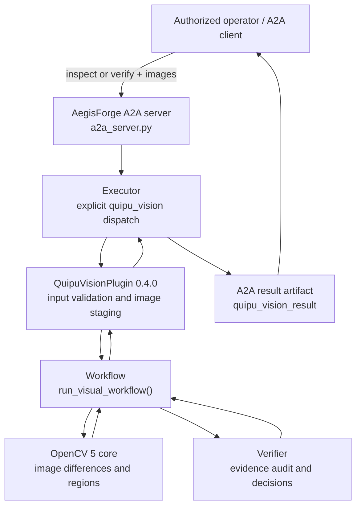
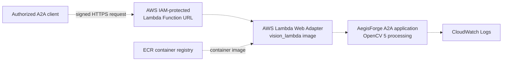

# Quipu Vision — OpenCV AI Competition 2026

**Technical submission and judge demonstration guide**  
**Project:** Quipu Vision, an opt-in visual inspection capability in AegisForge  
**Runtime evaluated:** OpenCV **5.0.0**, Quipu Vision AegisForge plugin **0.4.0**  
**Submission status:** **DRAFT — local implementation validated; AWS execution and final publication still pending**  
**Document date:** 23 October 2026

> **Accuracy and deployment disclosure:** All measurements here are from a small synthetic image benchmark on the developer's local Windows environment, and all prior image-bearing A2A integration demonstrations were local (Windows or Linux Docker). **No successful AWS-hosted image-processing execution has been demonstrated.** The competition requires substantive OpenCV 5 analysis **and** a meaningful component running on AWS. A prepared cloud deployment design cannot substitute for a successful deployment.

## 1. Project overview

**Quipu Vision** is a bounded, evidence-driven image-change inspection workflow that helps an operator distinguish a first visual difference from a difference that persists in a later observation. Rather than interpreting a pixel difference as a definitive real-world event, the system can request another image, re-run OpenCV processing, audit evidence, and recommend human review.

The project integrates an installable `Quipu-Vision/` Python package into AegisForge's existing **Agent-to-Agent (A2A)** server. Clients can submit image bytes through A2A data/file parts or permitted local paths. The response includes structured observations, provenance, decisions, and a machine-readable `quipu_vision_result` artifact.

**Primary demonstration scenario:** inspection of a fixed-camera view of a shared space or workstation to identify and reassess visible scene changes. This is a prototype for controlled inspection workflows, **not** a tested surveillance system, object detector, autonomous camera, or safety-certified product.

**Potential users:** developers of visual automation prototypes, quality-control researchers, and teams evaluating human-in-the-loop inspection designs. Potential usefulness is a proposed application, not a field-validated impact claim.

## 2. Problem and proposed approach

Traditional image-difference algorithms can detect changes caused by both meaningful scene modifications and nuisance factors: shadows, lighting changes, glare, and slight camera movement. Treating every change as confirmed can produce misleading alerts; ignoring weak differences can miss subtle changes.

Quipu Vision therefore distinguishes four outcomes:

| Evidence available | Workflow outcome | Meaning |
|---|---|---|
| No significant initial pixel change | `continue_monitoring` | No change was detected under the configured threshold; this does **not** certify that the scene is safe or unchanged in every sense. |
| Initial pixel change without follow-up | `request_second_observation` | More visual evidence is needed. |
| First and second observations show spatially persistent changed regions | `request_human_review` | Pixel-region persistence is confirmed; human interpretation is still required. |
| Change does not persist or evidence is inconclusive | `review_conditions_or_repeat` | Repeat/review the inspection rather than claim confirmation. |

A human or external client supplies follow-up imagery. **The current system does not automatically control or sample a camera.**

## 3. What is actually implemented

### 3.1 Local architecture



**Main source locations, relative to the AegisForge root:**

- `Quipu-Vision/src/quipu_vision/core.py` — image decoding, comparison, ROI processing, changed regions, annotation and provenance.
- `Quipu-Vision/src/quipu_vision/workflow.py` — first inspection, optional second inspection and workflow trace.
- `Quipu-Vision/src/quipu_vision/verifier.py` — evidence consistency and next-action decisions.
- `Quipu-Vision/src/quipu_vision/schemas.py` — typed observations, verification and decision objects.
- `src/aegisforge/plugins/examples/quipu_vision.py` — opt-in plugin and validation boundaries.
- `src/aegisforge/executor.py`, `src/aegisforge/a2a_server.py` — A2A request routing, artifact delivery, health and capability endpoints.

The implementation is **opt-in** (`AEGISFORGE_ENABLE_QUIPU_VISION=true`) and selected explicitly with `capability: "quipu_vision"`; ordinary AegisForge requests retain their existing route. For an illustrated and more complete design, see [architecture.md](architecture.md).

### 3.2 Substantive OpenCV 5 workload

The detector decodes two same-dimension images, applies Gaussian blur, computes an absolute grayscale difference, thresholds it, performs morphological cleanup, extracts contours, and filters small regions. It can restrict detection to a rectangular region of interest (ROI) and generate an annotated visual output.

In the evaluated synthetic dataset, the configured difference threshold was **32** and the minimum region fraction **0.004**. For a supplied follow-up, the workflow compares that image against the **same original reference** and checks spatial overlap of changed bounding boxes (IoU threshold **0.2**). The result indicates **persistent pixel change only**, not object identity, an inferred hazard, or a safety guarantee.

Input handling includes supported PNG/JPEG/BMP/WebP formats, bounded input sizes, path restrictions, MIME/signature checks for inline images, and cleanup of temporary staged files. Invalid inputs and inconsistent audit results must not be converted into verified success.

### 3.3 Agentic/human-in-the-loop behavior

This is a deterministic, bounded perception–decision–re-observation loop:

1. The client submits **reference** and **observed** images through A2A `message/send` with `operation: "inspect"`.
2. OpenCV 5 evaluates changed regions. For a detected change without follow-up, the output requests `request_second_observation` with `verified: false`.
3. The client/operator obtains and submits a **follow-up** image through `operation: "verify"`.
4. The workflow performs a **new OpenCV inspection** and audits whether the changed region persists spatially.
5. For the demonstrated persistent-change case, the result is `request_human_review` with `verified: true`, meaning **pixel persistence** and nothing more.

The visual observation changes the next requested action, instead of merely producing a chatbot description. This is relevant to the optional **Agentic Vision** path; however, eligibility and scoring are determined by the competition's judges, and the required demonstration/trace must be included in the final submission.

## 4. Implemented local validation

The developer has previously demonstrated the following in Windows and local Linux Docker environments:

| Component / check | Observed evidence | Status |
|---|---|---|
| Runtime | `cv2.__version__` = **5.0.0** | Confirmed from provided Windows console output |
| Plugin | Capability endpoint reports plugin **0.4.0**, OpenCV **5.0.0** and A2A task support | Previously demonstrated locally |
| A2A initial inspection | Completed `inspect`; `verified: false`; next action `request_second_observation` | Previously demonstrated locally |
| A2A follow-up | Completed `verify`; `verified: true`; next action `request_human_review` | Previously demonstrated locally, including Docker |
| Linux container | `docker build --target vision` completed and service health/capabilities responded | Previously demonstrated locally |
| Unit/integration-oriented workflow tests | **33 of 33 passed**, **0.870 s** total | Confirmed from provided Windows console output |
| AWS-hosted processing | No confirmed image-bearing invocation, cloud log or service endpoint | **NOT COMPLETE** |

The **33 passing tests** verify specified behavior in their tested scenarios, not 100% detector accuracy.

## 5. Quantitative evaluation (OpenCV 5.0.0)

**Data:** 24 programmatically generated synthetic scenarios, using 23 PNG assets in a shared stylized fixed-camera scene (320 × 240 pixels). The test cases are correlated and are **not** a representative real-world sample. Seven scenarios also have spatial-persistence labels. The labels come from image-generation operations rather than model predictions. Dataset integrity is checked with SHA-256 entries in `manifest.json`.

### 5.1 Initial image-change detection

| Statistic | Result |
|---|---:|
| Cases | **24** |
| True positives / true negatives | **12 / 6** |
| False positives / false negatives | **4 / 2** |
| Accuracy | **75.00%** |
| Precision | **75.00%** |
| Recall | **85.71%** |
| F1 | **0.8000** |

### 5.2 Spatial persistence after a follow-up

| Statistic | Result |
|---|---:|
| Labeled cases | **7** |
| True positives / true negatives | **4 / 2** |
| False positives / false negatives | **0 / 1** |
| Accuracy | **85.71%** |
| Precision | **100.00%** (4 predicted positives; **not** evidence of general reliability) |
| Recall | **80.00%** |
| F1 | **0.8889** |

### 5.3 Timing and failures

- **Mean workflow time:** **8.11 ms** per evaluated scenario.
- **95th-percentile workflow time:** **14.56 ms**.
- **Execution errors:** **0**.
- **Label mismatches:** **7 stage-level discrepancies across 6 distinct scenario IDs**.

The timing values cover the **local evaluated workflow call**, possibly including file access and follow-up processing. They are **not** AWS latency, end-to-end network latency, real-time camera throughput or a sustained-load benchmark.

**Observed false positives:** strong illumination (`no_change_strong_lighting`), shadow (`no_change_shadow`), camera movement (`no_change_camera_motion`), and glare (`no_change_glare`). **Observed false negatives:** low-contrast object appearance (`low_contrast_object`) and low-contrast persistence (`low_contrast_persists`). The latter also failed to confirm persistence end-to-end because the initial change was not detected.

The full confusion matrices, labeling method, per-case discrepancies, test commands and limitations appear in [evaluation.md](evaluation.md). The locally generated machine-readable report is `outputs/quipu_vision/evaluation-results.json`; **this submission document was written from the supplied console summary, not from independent examination of that local JSON file**.

## 6. Reproducibility and local judge demonstration

### 6.1 Source and dependencies

This implementation consists of the existing AegisForge package plus the nested installable `Quipu-Vision/` package. The root and nested `pyproject.toml` files specify project dependencies; the nested project pins its OpenCV wheel requirement as `opencv-python==5.0.0.93`. To reproduce the exact evaluated runtime, check that `cv2.__version__` prints `5.0.0` before comparing results.

**Important publication status:** The publicly inspected AegisForge `main` branch was still at commit `9167fbef1215f566ce0fc06d8d6006473b1ecd0c` and did **not** yet include the new local Vision files. **Do not provide this branch as if it were the complete judge-accessible submission until the actual Vision implementation, tests and documentation are published or supplied in an accessible archive.**

**Upstream repository (pre-publication reference only):** https://github.com/ivanjojo369/AegisForge_agent  
**Final judge-accessible source URL or archive:** **[PENDING — insert verified URL after publication]**  
**Pinned release/commit identifier:** **[PENDING — insert only after freezing the final version]**

### 6.2 Reproduce metrics and tests on Windows

At the repository root, in an environment with the two packages and OpenCV 5 installed:

```powershell
cd C:\Users\PC\Documents\AGI-Prototipo\AegisForge_agent
$python = ".\.venv\Scripts\python.exe"

# Confirm the OpenCV version.
& $python -c "import cv2; print('OpenCV:', cv2.__version__)"

# Check the 33 workflow tests.
& $python -m unittest discover `
  -s ".\Quipu-Vision\tests" `
  -p "test_workflow.py" -v

# Evaluate the labeled synthetic scenarios.
New-Item -ItemType Directory -Force ".\outputs\quipu_vision" | Out-Null
& $python ".\Quipu-Vision\examples\evaluation\evaluate.py" `
  --json-out ".\outputs\quipu_vision\evaluation-results.json"
```

A clean-machine installation must also follow the project's respective `pyproject.toml` files and compatibility constraints; the above commands assume the developer's existing prepared `.venv`, rather than claiming a clean installation has been independently validated.

### 6.3 Start the local Linux Docker service

From the root of `AegisForge_agent/` with Docker Desktop's Linux container engine:

```powershell
docker build --target vision -t aegisforge-vision:0.4 .
docker run --rm --name quipu-vision -p 127.0.0.1:8001:8001 aegisforge-vision:0.4
```

In a second terminal:

```powershell
Invoke-RestMethod http://127.0.0.1:8001/health
Invoke-RestMethod http://127.0.0.1:8001/vision/capabilities
```

These two GET endpoints confirm readiness only; they **do not** exercise image analysis. For the actual demo, send a `message/send` request using `capability: "quipu_vision"` and `operation: "inspect"` or `"verify"`, attaching the included `Quipu-Vision/examples/demo/` images through A2A data or `FileWithBytes` parts. Inspect the resulting artifact named `quipu_vision_result` and its `next_action`. The image-bearing request has been tested locally, but the current repository does not contain a separately verified copy of the interactive PowerShell caller script.

### 6.4 Required demonstration access

The final competition submission must include **either** a working endpoint **or** an arranged live screen-share demonstration. The local `127.0.0.1` service is accessible to the developer, **not remotely to the judges**. An IAM-protected AWS Lambda Function URL, if deployed, also requires authorized credentials; do not present it as a publicly accessible endpoint.

**Demonstration mode for judges:** **[PENDING — working authorized endpoint OR confirmed live screen-share details]**  
**Judge demo URL / instructions:** **[PENDING]**

## 7. AWS component: intended architecture, not a completed deployment

The official competition requires that a meaningful component run on AWS. The current intended deployment is:



**Prepared deployment artifacts:** `Dockerfile` target `vision_lambda` and CloudFormation template `infra/aws/vision-lambda.yaml`. This is a **proposed deployment topology** and does not imply that the image has been pushed to ECR or the Lambda service has been created.

**AWS completion evidence required before claiming compliance:**

1. Record the deployed region and AWS services, authorized account-access arrangement, and deployed image digest or version (without publishing account secrets).
2. Demonstrate an actual **image-bearing A2A call executed by the AWS-hosted workload**, returning the expected result artifact and a trace or appropriate redacted log.
3. Document secure endpoint access, operational limits, observed execution errors and reproducible deployment steps.
4. Measure AWS-specific invocation latency if performance claims about cloud execution are made; never copy local latency figures into a cloud benchmark.

**AWS deployment status: NOT VERIFIED / PENDING.** A local Docker run is not sufficient to meet the AWS portion of the competition rules. Cloud resources, if ever created, should only be operated under authorized ownership, with payment and access approvals where applicable.

## 8. Responsible use, ethics and known limitations

- **Interpretation:** `verified: true` means a changed pixel region persisted spatially, **not** that an object was identified, an intrusion established, or a scene declared safe/unsafe.
- **Operator oversight:** Consequential actions should require human confirmation. The system produces recommendations, not physical actuator commands.
- **Data permissions:** Use synthetic or properly authorized images; avoid capturing bystanders or private premises without permission. Ensure judge-facing assets can be shared.
- **Privacy:** Do not publish image payloads, sensitive logs or account credentials. Retention, deletion and access controls require deployment-specific review.
- **Robustness:** Strong illumination changes, shadows, glare and camera displacement caused false positives; weak contrast caused false negatives in the synthetic benchmark.
- **Scope:** No autonomous camera control, streaming video, object classification, long-term entity tracking, or validated real-world safety performance is claimed.
- **Evidence:** The 24-case benchmark is a reproducible synthetic baseline, not a field study. Human-review decisions do not constitute validated alarms.
- **Operations:** Production security, observability, availability, cost and service-level objectives have not been established by local tests.

## 9. Video outline for judges (maximum 5 minutes)

**Video status:** **[PENDING — record and upload a public/unlisted judge-accessible video]**  
**Final video link:** **[PENDING — insert actual URL]**

| Time | Scene and evidence |
|---|---|
| 0:00–0:35 | Brief team/project introduction, user problem and bounded inspection use case. |
| 0:35–1:10 | Show implemented architecture and OpenCV 5 processing pipeline. |
| 1:10–2:00 | Live/local A2A `inspect`: first difference leads to `request_second_observation`; show real artifact. |
| 2:00–2:55 | A2A `verify`: client supplies follow-up; actual reinspection leads to `request_human_review` for persistent pixel change. |
| 2:55–3:35 | Show reproducible tests: **33/33** passed and synthetic evaluation **24 cases**, including failures. |
| 3:35–4:10 | Explain four false positives, two initial false negatives, and the human-review/safety limitations. |
| 4:10–4:50 | Show **AWS-hosted image processing only if actually deployed and verified**; otherwise openly identify AWS as pending. |
| 4:50–5:00 | Summarize what works, what remains, and links/credits. |

The final video must include the team, the app working, architecture and principal results. A recorded local demo cannot be represented as an AWS demo.

## 10. Ready-to-adapt Devpost text

### Project title

**Quipu Vision — Auditable OpenCV 5 Re-observation for A2A Agents**

### Short description

*An OpenCV 5 image-change workflow that turns visual evidence into a request for re-observation and an auditable, human-reviewed decision through AegisForge A2A.*

### Inspiration

Single-frame differences can be caused by scene changes, lighting and camera movement. A useful visual agent should distinguish preliminary evidence from verification and avoid claiming safety or object identity from pixels alone.

### What it does

Quipu Vision compares reference and observed images, highlights meaningful changed regions, and returns a structured next action. A detected difference can prompt a request for a follow-up image. If a later supplied image shows persistent spatial change, the workflow produces auditable evidence and recommends human review.

### How it was built

The project uses OpenCV 5.0.0 for image comparisons, a Python workflow/verifier for evidence checking, and an opt-in plugin integrated with AegisForge's A2A/Starlette server. It accepts supported images as permitted paths or encoded A2A attachments and runs in a tested local Linux Docker container. A proposed AWS Lambda/ECR deployment has been prepared but **has not yet been validated in AWS**.

### Results and what was learned

A local 24-scenario synthetic benchmark achieved 75.00% accuracy and 0.8000 F1 for initial scene-change detection. A seven-case persistence subset achieved 85.71% accuracy and 0.8889 F1. The workflow passed 33/33 local functional tests with OpenCV 5.0.0. The experiment also revealed false positives under shadows, glare, lighting and camera motion, and missed low-contrast changes; the figures do not represent field reliability.

### Challenges and next steps

Improve illumination/camera-motion robustness, evaluate diverse permission-cleared real scenes, validate cloud execution under authorized AWS access, and add clearer operator-facing trace visualization. Real-time video capture, object classification and automated actuation are outside the present prototype.

## 11. Final publication checklist

### Completed or evidenced locally

- [x] Substantive OpenCV **5.0.0** processing in the demonstrated local environment.
- [x] A2A `inspect`/`verify` behavior and image-bearing local integration demonstrations.
- [x] Local Docker Linux image build and image-bearing A2A verification.
- [x] **33/33** functional workflow tests passing on OpenCV 5.0.0.
- [x] Quantitative synthetic evaluation: 24 initial cases, 7 persistence labels, failure analysis.
- [x] Technical architecture document: [`architecture.md`](architecture.md).
- [x] Evaluation document: [`evaluation.md`](evaluation.md).
- [x] This submission document drafted from verified evidence.

### Must be completed or independently verified for final submission

- [ ] Deploy and demonstrate **meaningful OpenCV 5 processing actually executing on AWS**; preserve a redacted trace/evidence.
- [ ] Publish or otherwise provide the **complete current** implementation in a judge-accessible repository/archive, with a fixed revision and dependencies.
- [ ] Confirm the complete artifact includes `Quipu-Vision/`, tests, evaluation assets, architecture, and this report.
- [ ] Verify clean-build and installation/deployment instructions against the submitted version.
- [ ] Include an architecture diagram clearly labeling the **actually deployed** AWS components, if deployment succeeds.
- [ ] Provide a **working judge-accessible endpoint** or arrange a **live screen-share** demonstration.
- [ ] Record and share a **public/unlisted video ≤ 5 minutes** that demonstrates team, app, architecture and results.
- [ ] Supply the final video URL and final repository/archive URL in Devpost.
- [ ] Confirm content licensing, image-sharing rights, and any platform/guardian permission required for eligibility.
- [ ] Recheck the submitted links and required Devpost fields before the deadline.

**Optional enhancements, not claims of current completion:** independent real-scene validation, richer annotated demonstrations, repeated timing runs, operator UI improvements and additional Agentic Vision traces.

## 12. Competition requirements and status note

The organizer's [competition overview](https://opencv26.devpost.com/) requires a technical report, judge-accessible code, reproducible dependencies and instructions, architecture diagram, demo access, a video of up to five minutes, evaluation evidence, **OpenCV 5**, and a meaningful workload on **AWS**. The [official rules](https://opencv26.devpost.com/rules) provide the judging and eligibility terms.

**Deadline discrepancy:** Devpost's visible countdown/header states **26 October 2026, 11:45 p.m. PDT**, while some descriptive text states **11:59 p.m. Pacific**. Use the earlier **11:45 p.m. PDT** cutoff when planning the submission. Exact active times and eligibility should be checked on the submission page before final submission.

**Competition eligibility discrepancy:** The main overview lists legal-age-of-majority participation, while the more detailed rules describe eligibility from age 13 with parental/legal-guardian permission and any required platform forms for minors. Applicants affected by the discrepancy should check with the organizer and comply with the platform requirements; do not infer eligibility merely from this document.

**Final status as written:** **Engineering prototype locally validated; technical submission documentation prepared; submission is not yet complete or demonstrated compliant with the AWS requirement.**
